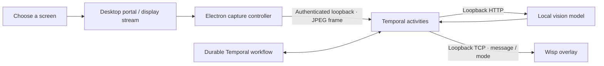

# Wisp

**A quiet desktop spirit for Linux.**

Wisp is a floating desktop companion that understands what is happening on your screen and offers contextual assistance using a locally running vision model.

It stays out of your way until you need it. You control when screen sharing starts and stops, while local inference keeps screenshot data on your machine.

[](https://github.com/GhananilShirpurkar/wisp/actions/workflows/ci.yml)
[](LICENSE)
[](package.json)

[Quick Start](#quick-start) · [Setup Guide](docs/SETUP.md) · [Architecture](docs/ARCHITECTURE.md) · [Contributing](CONTRIBUTING.md)


## What is Wisp?

Wisp brings contextual AI assistance directly to your desktop through a lightweight floating companion.

### Key Features

- **Floating Desktop Companion** — A transparent ghost overlay with click-through behavior, friendly and after-hours modes, five visual effects, and persistent motion preferences.
- **User-Controlled Screen Sharing** — Explicitly start and stop screen sharing. Wayland uses the desktop portal, while X11 captures the primary display.
- **Local AI Vision** — Uses Ollama and a vision-capable model to describe screen content and answer questions about it. Screenshot data stays on your machine.
- **Contextual Awareness** — Detects active-window changes and periodically analyzes screen content to maintain relevant observations.
- **Durable Background Workflows** — Temporal manages retries, rolling observations, pending questions, cooldowns, and workflow history rollover.
- **Linux Service Integration** — Optional systemd user services manage the worker, local Temporal server, and desktop overlay.

## Quick Start

### Requirements

- Linux with an X11 or XWayland graphical session
- Node.js 22 or later
- npm

### Installation

```bash
git clone https://github.com/GhananilShirpurkar/wisp.git
cd wisp

npm ci
npm run build
npm run demo
```

The demo runs without Ollama or Temporal and does not capture your screen.

Click the ghost to open its controls. Press `Escape` to close the panel, or use **Quit** to exit the overlay.

### Running Wisp with AI

For live screen assistance, additional dependencies are required:

- [Temporal CLI](https://docs.temporal.io/cli)
- [Ollama](https://ollama.com/)
- A vision-capable Ollama model
- A working desktop portal and PipeWire stack for Wayland

Check your environment and configure the application:

```bash
npm run doctor
cp .env.example .env
```

Configure the environment variables before starting the live worker.

Dependencies, models, permissions, and services are not installed or enabled automatically.

For detailed instructions, see the [Setup Guide](docs/SETUP.md).

## Platform Support

| Environment | Screen Capture | Window Detection | Floating Overlay |
|---|---|---|---|
| Linux / Wayland | Desktop portal + PipeWire | Timed sampling; native window titles unavailable | Requires XWayland |
| Linux / X11 | Primary display after explicit consent | `xprop`, with timed fallback | X11 |
| Pure Wayland without XWayland | Not fully supported | — | Not implemented |
| macOS | Legacy capture code retained | Legacy AppleScript adapter | Not tested |

Desktop compatibility is still being evaluated. When reporting issues, include your Linux distribution, desktop environment, and session type.

## Architecture

Wisp uses a local-first architecture that separates screen capture, AI inference, workflow orchestration, and desktop presentation.



### Processing Flow

1. **Screen Selection** — The user explicitly chooses to share their screen.
2. **Frame Capture** — The Electron capture controller obtains screen frames through the appropriate Linux capture mechanism.
3. **Local Processing** — Frames are sent to the local worker through an authenticated loopback connection.
4. **Vision Analysis** — The worker sends frames to Ollama for local screen analysis.
5. **Workflow Management** — Temporal coordinates observations, retries, pending questions, and background execution.
6. **Desktop Interaction** — The worker communicates relevant messages and modes to the floating Wisp overlay.

### Observation Cycle

- The worker checks the active window every five seconds.
- Vision analysis runs when a window change is detected or after 45 seconds.
- Native Wayland sessions rely on timed sampling.
- The active observation state retains 30 minutes of observations.
- Workflow history rolls into a new workflow hourly.

For more technical details, see [Architecture and Boundaries](docs/ARCHITECTURE.md).

## Privacy and Security

Wisp is designed to keep screen analysis local.

- **Explicit Consent:** Screen capture requires worker opt-in and an active user-approved sharing session.
- **Local Inference:** Screen frames are processed by a locally running Ollama model. Screenshot bytes remain in memory on Linux and are not stored in Temporal history.
- **Controlled Sharing:** Closing the screen-sharing window stops future captures. An inference operation that has already started may finish.
- **Local Workflow History:** Window titles, questions, and model observations are persisted in local Temporal history.
- **Loopback Communication:** The capture bridge and overlay communication use local connections.
- **Optional Telemetry:** Sentry integration is disabled unless explicitly configured and exports allowlisted metrics.

### Security Considerations

- The capture bridge uses a token readable by the local user. It does not protect against malicious software running under the same user account.
- The overlay-message port is unauthenticated and accepts messages from local processes.
- Both communication ports should remain bound to loopback.
- The 30-minute observation window does not delete older records from the Temporal database.

Read the [Security Policy](SECURITY.md) and [Setup Guide](docs/SETUP.md#privacy-and-local-boundaries) before enabling live screen assistance.

## Development

### Available Commands

```bash
npm test                    # Build + unit and loopback integration tests
npm run test:ui             # Native Electron tests using synthetic video
npm run check:workflow      # Validate the Temporal workflow bundle
npm run format:check        # Check code formatting
npm run wisp:test -- all    # Test effects; requires a running overlay
```

### CI

The CI pipeline:

- Runs core tests on Node.js 22 and 24.
- Validates the Temporal workflow bundle.
- Runs Electron smoke tests under a virtual X11 display.

The CI pipeline does not grant desktop portal consent or run a real vision model.

See [Validation Details](docs/VALIDATION.md) for completed tests and remaining verification work.

## Contributing

Contributions, bug reports, and suggestions are welcome.

Before submitting an issue, include relevant environment details such as:

- Linux distribution and version
- Desktop environment
- Display server (Wayland or X11)
- Node.js version
- Steps to reproduce the issue

See [CONTRIBUTING.md](CONTRIBUTING.md) for contribution guidelines.

## License

Wisp is released under the [MIT License](LICENSE).
