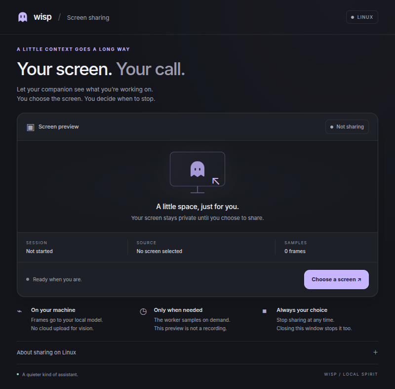
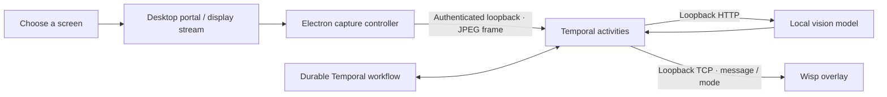

<div align="center">

# Wisp

**A quiet desktop spirit for Linux.**

A floating companion that can see the screen you choose, reason with a local vision model, and offer help without sending screen images to a cloud model.

[](https://github.com/GhananilShirpurkar/wisp/actions/workflows/ci.yml)
[](LICENSE)
[](package.json)

[Quick start](#quick-start) · [Full setup](docs/SETUP.md) · [Architecture](docs/ARCHITECTURE.md) · [Contributing](CONTRIBUTING.md)

</div>



> **Development preview.** Component tests and synthetic Electron capture tests pass locally. The full real-screen → Ollama → Temporal → overlay flow has not yet been verified end to end. Wisp is not a packaged or production-certified release.

## What Wisp does

- **A companion, not another dashboard.** A transparent ghost overlay with click-through behavior, friendly and after-hours modes, five effects, and saved motion preferences.
- **Screen sharing you control.** Start and stop sharing explicitly. Wayland uses the desktop portal; X11 shares the primary display. A live preview shows the session duration and actual sampled-frame count.
- **Local inference.** Ollama handles screen descriptions and on-demand questions. Screenshot bytes remain in memory on Linux and never enter Temporal history.
- **Durable observation.** Temporal handles retries, rolling observations, pending asks, cooldowns, and continue-as-new history rollover.
- **Linux lifecycle.** Optional systemd user services supervise the worker, local Temporal server, and overlay.

## Quick start

Requires Node.js 22+, npm, and a graphical Linux session with X11 or XWayland.

```sh
git clone https://github.com/GhananilShirpurkar/wisp.git
cd wisp
npm ci
npm run build
npm run demo
```

The demo works without Ollama or Temporal and never captures the screen. Click the ghost to open its controls. Escape closes the panel; Quit exits the overlay.

For live assistance, follow the [full setup guide](docs/SETUP.md). You need the Temporal CLI, Ollama with a vision-capable model, and a working desktop portal/PipeWire stack. Dependencies, models, permissions, and services are **not** installed or enabled automatically.

```sh
npm run doctor               # inspect local prerequisites
cp .env.example .env         # configure before starting a live worker
```

## Platform support

| Environment                   | Capture                                | Window-change detection                          | Floating overlay   |
| ----------------------------- | -------------------------------------- | ------------------------------------------------ | ------------------ |
| Linux / Wayland               | Desktop portal + PipeWire              | Timed sampling; native window titles unavailable | Requires XWayland  |
| Linux / X11                   | Primary display after explicit consent | `xprop`, with timed fallback                     | X11                |
| Pure Wayland without XWayland | Not a supported complete setup         | —                                                | Not implemented    |
| macOS                         | Legacy capture code retained           | Legacy AppleScript adapter                       | Not tested in Wisp |

Desktop compatibility still needs broader testing. Report the distribution, desktop, and session type when filing issues.

## How it works



The worker checks the active window every five seconds. Vision runs on a detected window change or after 45 seconds; native Wayland sessions use the timed cadence. Current state retains 30 minutes of observations and rolls into a new workflow history hourly. See [architecture and boundaries](docs/ARCHITECTURE.md).

## Privacy and limits

- Screen capture needs worker opt-in **and** an active user-approved share. Closing the sharing window stops future captures; an already-started inference may finish.
- Window titles, questions, and model observations are persisted in local Temporal history. The 30-minute memory window does **not** delete older database history.
- The capture bridge requires a token readable by your local user. It does not protect against malicious software running as that same user.
- The separate overlay-message port is unauthenticated and accepts messages from local processes. Keep both ports on loopback.
- Optional Sentry exports allowlisted metrics. It is disabled unless configured. See [security](SECURITY.md) and the [setup guide](docs/SETUP.md#privacy-and-local-boundaries).

## Development

```sh
npm test                     # build + unit and loopback integration tests
npm run test:ui              # native Electron tests; uses synthetic video
npm run check:workflow       # validate the Temporal workflow bundle
npm run format:check         # formatting
npm run wisp:test -- all     # effects; requires a running overlay
```

CI runs the core tests on Node 22 and 24, validates the Temporal bundle, and runs the Electron smoke test under a virtual X11 display. It does not grant desktop portal consent or run a real vision model. [Validation details and remaining checks](docs/VALIDATION.md).

## Origin and attribution

Wisp was developed from reverse-engineering notes and a supplied TypeScript reimplementation of [Bennykillua/paperclip-ghost](https://github.com/Bennykillua/paperclip-ghost), the original macOS desktop ghost. Credit for the original concept and architecture belongs to **Benny (Bennykillua)**.

Wisp adds Linux portal capture, a token-authenticated capture bridge, systemd services, a redesigned interface, stronger input validation, and tests. It does not implement all of the original project's setup commands or effects. It is an independent repository, not an official release or endorsed port. See [attribution and differences](ATTRIBUTION.md).

Licensed under [MIT](LICENSE), with the upstream copyright notice preserved.
